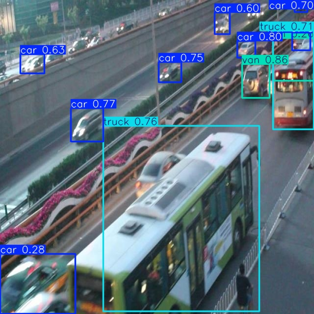
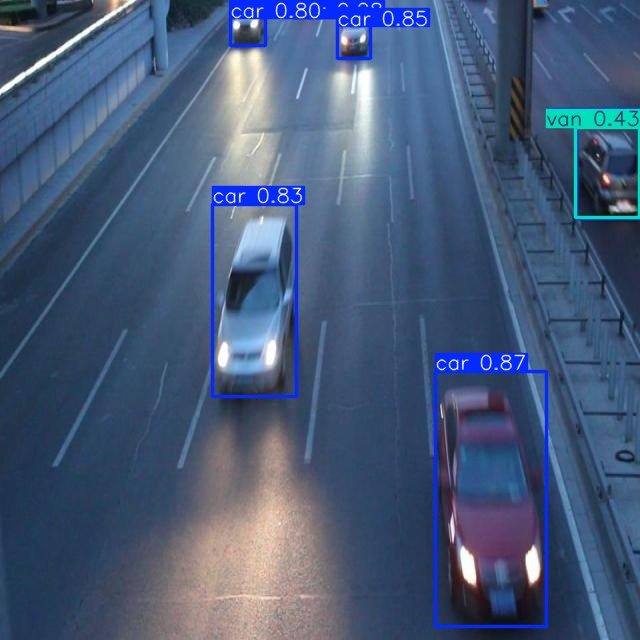

# Báo cáo cá nhân — Ngày 2 Object Detection

Đổi tên file theo `MSSV_HoTen.md`, ví dụ `20241234_NguyenVanAn.md`. Điền kết quả thật, xóa dòng hướng dẫn khi nộp. Xem [quy định nộp](../../SUBMISSION.md).

## 1. Thông tin học viên

- Họ tên:Cù Việt Đức
- MSSV:2A202603042
- Email:cuvietduc2203@gmail.com
- Lớp:l2A
- Link repo bài làm:
- Link Colab đã chạy:https://colab.research.google.com/github/CuDuc2211/K5-L2A-DAY02-CUVIETDUC-2A202603042-ObjectDetection/blob/main/notebooks/day2_annotation_to_yolo.ipynb

## 2. Schema và mini guideline

Dẫn tới [GUIDELINE_MINI.md](../../GUIDELINE_MINI.md). Tóm tắt ba ca mơ hồ đã quyết định, cách áp dụng schema và phần cần giảng viên làm rõ.

## 3. Annotation và self-QC

- Số file nhãn train:50
- Kết quả checker và lỗi đã xử lý:đạt cấu trúc
- Danh sách ít nhất 10 ảnh đã rà bằng mắt:039 đến 049
- Lỗi bỏ sót/box/class phát hiện khi rà và cách sửa:bổ xung thêm box
- Commit khóa nhãn ban đầu:

## 4. Gold QC và rework

| Chỉ số | Trước sửa | Sau sửa nếu có |
|---|---:|---:|
| TP | 489| |
| FP | 535| |
| FN | 164| |
| Precision | 0.4775| |
| Recall | 0.7489| |
| F1 | 0.5832| |
| mean_iou_of_matches | 0.8412| |
| passed | true| |

Dẫn tới `outputs/annotation_evaluation.json` trong repo. Nếu rework, ghi ảnh, lỗi đã kiểm, quyết định sửa/giữ và lý do. Không suy nguyên nhân chỉ từ FP/FN. Không có rework thì ghi rõ.

## 5. Kết quả YOLO

- Runtime, GPU/CPU, phiên bản Ultralytics và Torch:
- Các tham số thay đổi so với notebook nếu có và lý do:
- Đường dẫn best checkpoint trong phiên chạy:

| Chỉ số trên 10 ảnh eval | Giá trị |
|---|---:|
| Precision | 0.41289065296296756|
| Recall | 0.49078071997228623|
| mAP50 | 0.46685165114437516|
| mAP50–95 | 0.31744148341771045|

Đặt cả 2 folder `assets/eval_predictions/` và `assets/yolo26_runs/` (giải nén từ `day2_colab_outputs.zip`) cạnh báo cáo và dẫn link tương đối. Không chỉ ghi số; chỉ ra ít nhất một ảnh và vật thể cụ thể.

Trả lời bốn câu hỏi cuối notebook:

1. Lớp nào recall thấp nhất? Ảnh nào minh họa?
Lớp van có Recall thấp nhất, bằng 0.000. Theo bảng Validation, tập Eval có 12 đối tượng thuộc lớp van nhưng mô hình không phát hiện đúng đối tượng nào theo tiêu chí đánh giá.
van hay bị nhầm với car  
ví dụ 
2. Nếu mAP50 cao nhưng mAP50–95 thấp, cần kiểm điều gì trên box?
Cần kiểm tra độ chính xác của Bounding Box, bao gồm vị trí, kích thước và mức độ ôm sát phần thân xe.
3. Lỗi class nào có thể liên quan guideline? Dữ kiện nào hỗ trợ nhận xét?
Lỗi nổi bật là mô hình nhầm lớp bus thành truck.
Lỗi này có thể liên quan đến việc phân biệt đặc điểm giữa bus và truck trong guideline hoặc tính nhất quán của dữ liệu gán nhãn.
4. Vì sao không dùng 10 ảnh eval để train? Vai trò validation của chúng trong notebook là gì?
Không sử dụng 10 ảnh Eval để train vì cần giữ chúng riêng khỏi tập dữ liệu được dùng để cập nhật trọng số mô hình.
Nếu đưa ảnh Eval vào Train, mô hình có thể học trực tiếp từ các ảnh dùng để đánh giá, khiến kết quả thiếu khách quan.

## 6. Khó khăn và cách xử lý

| Bước/thời điểm | Lỗi quan sát | Cách đã thử | Kết quả/còn thiếu |
|---|---|---|---|
| | | | |

## 7. Tự đánh giá theo rubric

Đối chiếu [RUBRIC.md](../../RUBRIC.md): phần nào đã có kết quả, phần nào còn thiếu hoặc chưa kiểm được. Không tự nhận hoàn thành bước chưa chạy.

## 8. Công cụ AI và tài liệu tham khảo
chatgpt :hỏi định nghĩa hướng dẫn cách làm gợi ý hướng giải quyết 
Ghi công cụ đã dùng, dùng ở bước nào và phần đã tự kiểm tra; không dùng thì ghi rõ. Liệt kê nguồn ngoài repo được sử dụng. Không ghi mật khẩu/token hoặc đính kèm gold train.
